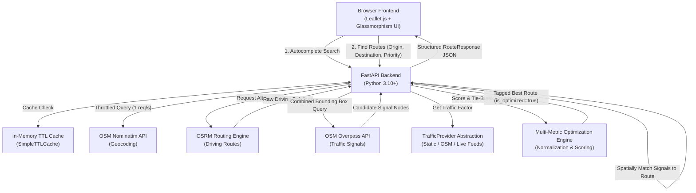

# Smart Traffic Route Optimizer

A 100% free, open-source Google Maps-style navigation dashboard for comparing and optimizing driving routes based on travel duration, distance, traffic signal density, and estimated signal delays.


---

## 🌟 Key Features & Highlights

- **100% Free & Open Source**: Zero commercial API keys required. No Google Maps billing, no Mapbox, TomTom, or HERE tokens.
- **Genuine Route Alternatives**: Requests up to 3 driving route alternatives from OSRM, discarding duplicates with geometric similarity analysis while preserving genuine detours and middle divergences.
- **Route-Specific Signal Detection**: Queries OpenStreetMap `highway=traffic_signals` nodes via Overpass API and spatially matches them to specific route geometries within 30 meters, keeping each route's signals strictly isolated.
- **Driving Order Progression**: Signals are sorted in progressive driving order (origin to destination) with cumulative distance along each route stored in meters.
- **Overlapping Coordinate Offset**: Automatically offsets overlapping signals at identical coordinates so every signal remains visually inspectable on the map.
- **Multi-Metric Optimization Engine**: Evaluates routes using normalized multi-metric scoring across travel time, signal count, distance, and traffic weighting, with deterministic tie-breaking.
- **Navigation Priority Modes**: Configurable priority presets for Balanced (Recommended), Fastest, Fewest Signals, and Shortest routes.
- **Visual Map Hierarchy**: Optimized route is prominently highlighted with a thick, vibrant emerald polyline (`#10b981`), while alternative routes appear in muted slate tones until selected.
- **Extensible Traffic Architecture**: Includes an abstract `TrafficProvider` interface, allowing plug-and-play addition of live road telemetry feeds (e.g. TomTom, Google Traffic, city sensors) without altering routing logic.
- **Fault-Tolerant Execution**: In-memory TTL caching, request throttling, exponential retries, and graceful fallback ensure route generation succeeds even if Overpass API is temporarily degraded.

---

## 🏗️ System Architecture



---

## 🗺️ Free Data Sources & Stack

| Component | Provider / Technology | Default Endpoint / Role |
| :--- | :--- | :--- |
| **Map Rendering** | Leaflet.js + OSM Tiles | `https://{s}.tile.openstreetmap.org/{z}/{x}/{y}.png` |
| **Geocoding** | OpenStreetMap Nominatim | `https://nominatim.openstreetmap.org/search` |
| **Routing Engine** | OSRM (Open Source Routing Machine) | `https://router.project-osrm.org` (or self-hosted) |
| **Traffic Signals** | OSM via Overpass API | `https://overpass-api.de/api/interpreter` + mirrors |
| **Backend** | Python 3.10+ / FastAPI / Uvicorn | Async HTTP (`httpx`), Pydantic validation |
| **Styling** | Vanilla CSS3 (Custom Properties) | Google Fonts (Outfit & Inter), FontAwesome icons |

---

## ⚙️ Configuration & Environment Variables

All parameters can be customized via `.env` file or environment variables:

| Variable | Default Value | Description |
| :--- | :--- | :--- |
| `HOST` | `127.0.0.1` | Server binding host |
| `PORT` | `8000` | Server binding port |
| `OSRM_URL` | `https://router.project-osrm.org` | OSRM routing endpoint |
| `OSRM_TIMEOUT` | `30.0` | OSRM HTTP timeout in seconds |
| `MAX_ROUTE_ALTERNATIVES` | `3` | Maximum distinct driving alternatives to return |
| `ROUTE_SIMILARITY_THRESHOLD`| `0.85` | Mutual geometry similarity ratio threshold for deduplication |
| `NOMINATIM_URL` | `https://nominatim.openstreetmap.org/search` | Nominatim search endpoint |
| `NOMINATIM_TIMEOUT` | `20.0` | Nominatim HTTP timeout in seconds |
| `OVERPASS_URL` | `https://overpass-api.de/api/interpreter` | Primary Overpass API interpreter |
| `OVERPASS_TIMEOUT` | `30.0` | Overpass HTTP timeout in seconds |
| `SIGNAL_MATCH_DISTANCE_METERS`| `30.0` | Max perpendicular distance from route to match a signal |
| `SIGNAL_DEDUP_DISTANCE_METERS`| `10.0` | Distance threshold to deduplicate opposing poles at an intersection |
| `AVERAGE_SIGNAL_DELAY_SECONDS`| `45.0` | Estimated delay allocated per traffic signal (45s baseline) |
| `GEOCODE_CACHE_TTL` | `3600` | Geocoding result cache duration (seconds) |
| `ROUTE_CACHE_TTL` | `300` | Routing result cache duration (seconds) |
| `SIGNAL_CACHE_TTL` | `3600` | Overpass signal bounding box cache duration (seconds) |
| `TIME_WEIGHT` | `0.50` | Travel duration weight for Balanced priority |
| `SIGNAL_WEIGHT` | `0.20` | Traffic signal count weight for Balanced priority |
| `DISTANCE_WEIGHT` | `0.20` | Route distance weight for Balanced priority |
| `TRAFFIC_WEIGHT` | `0.10` | Traffic factor weight for Balanced priority |
| `USER_AGENT` | `SmartTrafficRouteOptimizer/2.0 (...)` | OSM User-Agent compliance header |

---

## 🧠 Methodologies Explained

### 1. Route Generation & Deduplication
- OSRM is queried with `alternatives=3`, requesting up to 3 driving routes.
- Returned routes are checked for valid distance, duration, and GeoJSON coordinates.
- Route geometry similarity is evaluated by sampling coordinates along the cumulative distance of both routes.
- If two routes share more than `ROUTE_SIMILARITY_THRESHOLD` (85%) of their path and lack meaningful variation in distance or duration (>15%), the duplicate is removed, keeping the faster route.
- If OSRM returns fewer than 3 valid alternatives, only genuine routes are returned—routes are never fabricated.

### 2. Traffic Signal Matching & Progression
- An overall bounding box covering all route alternatives is computed with a geographic safety margin (0.015° ~ 1.5 km).
- Overpass API queries all `highway=traffic_signals` nodes within the bounding box.
- Signals are projected onto each route polyline:
  - Only signals within `SIGNAL_MATCH_DISTANCE_METERS` (30m) are associated with that specific route.
  - Clustered nodes within `SIGNAL_DEDUP_DISTANCE_METERS` (10m) representing multi-pole intersections are deduplicated.
  - Cumulative distance from the start point (`distance_along_route_m`) is computed for each signal.
  - Signals are strictly sorted in driving order from origin to destination.

### 3. Multi-Metric Optimization Engine
For each route, metrics are normalized against the candidate bounds:
$$\text{norm}(x) = \frac{x - \min(x)}{\max(x) - \min(x)}$$
*(When $\max(x) == \min(x)$, $\text{norm}(x) = 0.0$ to ensure zero-division safety)*

The composite optimization score is:
$$\text{Score} = w_{\text{time}} \cdot \text{norm}(T) + w_{\text{signal}} \cdot \text{norm}(S) + w_{\text{distance}} \cdot \text{norm}(D) + w_{\text{traffic}} \cdot C_{\text{traffic}}$$

- **Lower Score = Better Route**.
- Deterministic tie-breaking order:
  1. Lower Total Score
  2. Lower Travel Duration
  3. Lower Signal Delay
  4. Lower Driving Distance
- Exactly **one route** is marked with `is_optimized = True`.

### Priority Weight Presets
- **Balanced (Default)**: 50% Time, 20% Signals, 20% Distance, 10% Traffic
- **Fastest**: 70% Time, 10% Signals, 15% Distance, 5% Traffic
- **Fewest Signals**: 25% Time, 55% Signals, 15% Distance, 5% Traffic
- **Shortest**: 15% Time, 10% Signals, 70% Distance, 5% Traffic

---

## 📡 API Response Structure

### `POST /api/routes`
**Request:**
```json
{
  "start": { "latitude": 21.1524, "longitude": 79.0888 },
  "destination": { "latitude": 21.1558, "longitude": 79.0442 },
  "start_label": "Nagpur Railway Station",
  "destination_label": "Futala Lake, Nagpur",
  "preference": "balanced"
}
```

**Target Response:**
```json
{
  "source": {
    "latitude": 21.1524,
    "longitude": 79.0888,
    "label": "Nagpur Railway Station"
  },
  "destination": {
    "latitude": 21.1558,
    "longitude": 79.0442,
    "label": "Futala Lake, Nagpur"
  },
  "routes": [
    {
      "route_id": "route_1",
      "name": "Route 1 (via Amravati Road)",
      "geometry": {
        "type": "LineString",
        "coordinates": [[79.0888, 21.1524], [79.0600, 21.1540], [79.0442, 21.1558]]
      },
      "distance_m": 6200.0,
      "duration_s": 780.0,
      "distance_km": 6.2,
      "duration_min": 13.0,
      "signals": [
        {
          "id": "12345678",
          "latitude": 21.1530,
          "longitude": 79.0750,
          "distance_along_route_m": 1450.0,
          "estimated_delay_s": 45.0,
          "route_id": "route_1",
          "name": "RBI Square"
        }
      ],
      "signal_count": 5,
      "estimated_signal_delay_s": 225.0,
      "estimated_signal_delay_min": 3.8,
      "effective_duration_min": 16.8,
      "scores": {
        "time": 0.0,
        "signals": 0.05,
        "distance": 0.08,
        "traffic": 0.05,
        "total": 0.18
      },
      "is_optimized": true
    }
  ],
  "optimization": {
    "optimized_route_id": "route_1",
    "preference": "balanced",
    "weights": {
      "time": 0.5,
      "signals": 0.2,
      "distance": 0.2,
      "traffic": 0.1
    }
  },
  "metadata": {
    "traffic_source": "static",
    "signal_source": "OpenStreetMap",
    "routing_source": "OSRM"
  },
  "warning": null,
  "disclaimer": "Traffic signal timing is estimated. OpenStreetMap provides signal locations, not live signal phases or queue lengths."
}
```

---

## 🚀 How to Run the Application

### 1. Setup Virtual Environment
```bash
# Windows
python -m venv .venv
.venv\Scripts\activate

# Linux / macOS
python3 -m venv .venv
source .venv/bin/activate
```

### 2. Install Dependencies
```bash
pip install -r requirements.txt
```

### 3. Start the Server
```bash
python -m uvicorn app.main:app --reload --port 8000
```

### 4. Access the Navigation Dashboard
Open your browser at `http://127.0.0.1:8000`.
- Click **"Try Demo: Nagpur Station → Futala Lake"** for instant 1-click route demonstration.
- Or type any address in the Origin / Destination inputs to get Nominatim autocomplete suggestions.
- Or click directly on the Leaflet map to set your start and destination points.

---

## 🧪 Automated Test Suite

Run the full offline test suite:
```bash
.venv\Scripts\python -m pytest -v
```

### Test Coverage Summary:
- **`tests/test_geocoder.py`**: Valid search, empty search, caching verification, network timeout handling.
- **`tests/test_router.py`**: Valid OSRM response, multiple distinct routes, malformed rejection, duplicate elimination, timeout handling.
- **`tests/test_signals.py`**: Proximity matching (<=30m), far-point rejection, duplicate pole deduplication, multi-route isolation, driving order progression, Overpass failure fallback.
- **`tests/test_optimizer.py`**: Normal case, single route, identical metrics, deterministic tie-breaking, zero division protection, preference weighting.
- **`tests/test_api.py`**: `/api/health`, `/api/geocode`, `/api/routes` valid requests, invalid coordinates (422), Overpass failure graceful fallback.

---

## 🔄 Replacing OSRM or Traffic Providers

### Using Self-Hosted OSRM
To run high-throughput routing locally using Docker:
```bash
docker run -t -i -p 5000:5000 -v "${PWD}:/data" osrm/osrm-backend osrm-routed --algorithm mld /data/your-region.osrm
```
Then configure in `.env`:
```env
OSRM_URL=http://127.0.0.1:5000
```

### Adding Live Traffic Telemetry Feeds
The architecture includes `TrafficProvider` in `app/services/traffic_provider.py`. To connect a live traffic provider (such as TomTom, HERE, Google Traffic, or municipal TMC sensors):
1. Subclass `TrafficProvider`:
```python
class MyLiveTrafficProvider(TrafficProvider):
    async def get_traffic_factor(self, route_coords: List[List[float]]) -> float:
        # Query external live congestion feed along route coordinates
        return live_congestion_score  # float in [0.0, 1.0]

    def get_metadata(self) -> Dict[str, Any]:
        return {"traffic_source": "live_telemetry_provider"}
```
2. Update the factory `get_default_traffic_provider()` to instantiate your provider.
Routing and optimization automatically integrate the returned factor into the score breakdown without modifying map rendering or signal matching.

---

## ⚠️ Known Limitations & Disclaimers

1. **Estimated Signal Delays**: OpenStreetMap provides node locations tagged with `highway=traffic_signals`. It does **not** provide live red/green signal timing phases, cycle splits, or vehicle queue lengths. Signal delays are computed using the configured 45-second average baseline.
2. **OSM Public Usage Policies**: The application incorporates User-Agent headers, 1-second outbound request throttling for Nominatim, and in-memory TTL caching to strictly adhere to OpenStreetMap usage policies. For high-volume production deployments, self-hosting Nominatim, OSRM, and Overpass is recommended.

---

## 📄 License

Distributed under the MIT License. Free and open source for all.
# smart-traffic-route-optimizer

